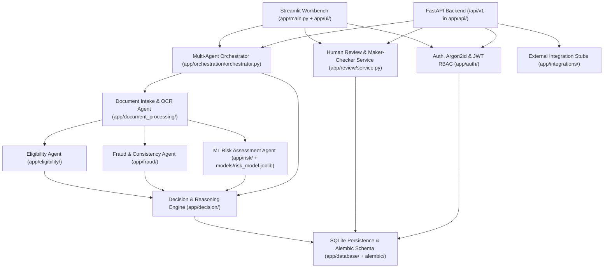

# System & Software Architecture — AI Loan Underwriting Assistant

**Primary Entry Points:**
- **Streamlit Workbench:** `app/main.py` (`streamlit run app/main.py`)
- **FastAPI Backend API:** `app/api/main.py` (`uvicorn app.api.main:app --port 8000`)

*(Note: `frontend/streamlit_app.py` is an obsolete Stage 1 static mockup shell and is not used by the active application.)*

---

## 1. High-Level Architecture Diagram

---

## 2. Layer-by-Layer Component Architecture

### 2.1 Streamlit Presentation Layer (`app/main.py`, `app/ui/`)
Coordinates an 8-screen workbench in [`app/ui/dashboard.py`](app/ui/dashboard.py) without duplicating domain rules:
- `Dashboard`, `Applications`, `Application Details`, `Audit History` ([`app/ui/views_portfolio.py`](app/ui/views_portfolio.py))
- `New Application` intake & PDF staging ([`app/ui/views_intake.py`](app/ui/views_intake.py))
- `Underwriting Results` & `Document Review` ([`app/ui/views_results.py`](app/ui/views_results.py))
- `Underwriter Review Queue` ([`app/ui/views_review.py`](app/ui/views_review.py))
- Session routing, token verification, and draft isolation ([`app/ui/state.py`](app/ui/state.py)), plus safe backend adapters ([`app/ui/services.py`](app/ui/services.py)) and formatting badges ([`app/ui/components.py`](app/ui/components.py)).

Streamlit acts strictly as the UI tier—not the security boundary in multi-user deployments—though in `APP_ENV=production` or `STREAMLIT_AUTH_REQUIRED=true` it enforces signed-in `AuthService` sessions cleanly.

### 2.2 FastAPI Backend (`/api/v1` in `app/api/`)
Exposes versioned REST endpoints via [`app/api/main.py`](app/api/main.py) with CORS rules, security headers (`X-Content-Type-Options`, `X-Frame-Options`, `Cache-Control: no-store`), and route modules:
- `auth.py` (`/api/v1/auth/*`): `login`, `refresh`, `logout`, `me`
- `users.py` (`/api/v1/users*`): Administrator user provisioning, updates, unlocking, deactivation
- `applicants.py` (`/api/v1/applicants*`): Applicant listing, lookup, registration
- `documents.py` (`/api/v1/applicants/{id}/documents`): Path-safe, `%PDF-`-validated PDF uploads (max 10 files per batch, 25 MB per file)
- `underwriting.py` (`/api/v1/underwriting/*`): Pipeline execution & run lookup
- `reviews.py` (`/api/v1/reviews/*`): Queue listing, case summary, Maker-Checker human decision submission, review history
- `audit.py` (`/api/v1/audit/*`): Filtered AI underwriting runs, human review events, summary analytics, daily trends
- `integrations.py` (`/api/v1/integrations/status`): Administrator adapter readiness inspection

### 2.3 Authentication & Authorization (`app/auth/`)
- **Cryptography** ([`app/auth/security.py`](app/auth/security.py)): Argon2id password hashing (`argon2-cffi`), constant-time `DUMMY_PASSWORD_HASH` fallback on missing accounts, HS256 JWT tokens constrained by `ALLOWED_JWT_ALGORITHMS = {"HS256", "HS384", "HS512"}` with `iss`, `aud`, `iat`, `nbf`, `exp`, `jti`, and `ver` claims.
- **Session Lifecycle** ([`app/auth/service.py`](app/auth/service.py)): Refresh-token rotation with replay/reuse detection (revoking the full session family if a rotated token is re-used), per-user `token_version` invalidation on logout/role-change/deactivation/lock, and SQL-backed sliding-window rate limiting per username and per IP.
- **RBAC & Maker-Checker** ([`app/auth/permissions.py`](app/auth/permissions.py)): Permission matrix across `ADMINISTRATOR`, `LOAN_OFFICER`, `UNDERWRITER`, and `SUPERVISOR`. Server-side dependencies (`require_permission`, `require_any_permission`) enforce route permissions, ownership scoping for Loan Officers, `enforce_not_self_review` across submissions and underwriting runs, and `enforce_correction_requires_supervisor`.

### 2.4 Applicant & Document Management, PDF Extraction & OCR (`app/document_processing/`)
- Security validation ([`app/document_processing/security.py`](app/document_processing/security.py)): `.pdf` extension check, 25 MB / 100-page bounds, `%PDF-` signature validation, passive active-content marker detection (`/JavaScript`, `/JS`, `/OpenAction`, `/Launch`, `/AA`), and regex PII/account masking (`mask_identifier`, `mask_sensitive_text`).
- Page-aware hybrid reading ([`pdf_reader.py`](app/document_processing/pdf_reader.py), [`ocr.py`](app/document_processing/ocr.py)): Inspects every page individually, applying Pillow preprocessing + local Tesseract OCR (`pytesseract`) selectively only to rasterized/image pages while preserving `page_number` provenance.
- Classification, extraction & validation ([`extractor.py`](app/document_processing/extractor.py), [`validation.py`](app/document_processing/validation.py), [`document_package.py`](app/document_processing/document_package.py)): Classifies `loan_application`, `identity_proof`, `address_proof`, `salary_slip`, `income_statement`, `employment_proof`, `bank_statement`, detects SHA-256 duplicates, preserves multi-document `field_conflicts`, and tags fields `valid`, `unverified`, `invalid`, `missing`, or `ambiguous`.

### 2.5 Eligibility Analysis (`app/eligibility/`)
Deterministic policy evaluator (`EligibilityEvaluator` in [`evaluator.py`](app/eligibility/evaluator.py)) checking 10 rules from [`policy.py`](app/eligibility/policy.py): document completeness, age bounds (`21–65`), minimum monthly income (`INR 30,000`), permitted employment types, loan amount/tenure bounds, credit score (`>= 650`), maximum DTI (`<= 60%`), extraction confidence (`>= 0.75`), and data completeness.

### 2.6 Fraud & Anomaly Detection (`app/fraud/`)
Local cross-document consistency detector (`CrossDocumentAnomalyDetector` in [`detectors.py`](app/fraud/detectors.py)) firing explainable rules:
- `ANOM-ID-001` (name consistency across documents)
- `ANOM-INC-001` (declared income vs salary slip / bank salary credits)
- `ANOM-FIN-001` (undisclosed recurring EMI obligations)
- `ANOM-FIN-002` (declared vs closing bank balance variance)
- `ANOM-DOC-001` (employer name consistency)

Produces bounded 0–100 anomaly score (`NONE`, `LOW`, `MEDIUM`, `HIGH`). **Missing documents are tracked strictly as `missing_evidence` and never reported as fraud.**

### 2.7 ML Risk Prediction (`app/risk/`)
- Shared feature contract (`RiskFeatureContract` in [`feature_contract.py`](app/risk/feature_contract.py)): Extracts `15` ordered features identically at training and inference time, preserving explicit zeros and strictly excluding `gender`.
- Serialized `SimpleImputer(strategy="median") + RandomForestClassifier` pipeline ([`models/risk_model.joblib`](models/risk_model.joblib), loaded fail-fast via [`risk_model.py`](app/risk/risk_model.py)) predicting risk tiers (`LOW`, `MEDIUM`, `HIGH`, `BORDERLINE`) alongside finite 0–100 risk scores and baseline comparison rules ([`scoring.py`](app/risk/scoring.py)). **Missing or non-finite risk scores never coerce to `0.0`.**

### 2.8 Multi-Agent Orchestration & Decision Engine (`app/orchestration/`, `app/decision/`)
- [`UnderwritingOrchestrator`](app/orchestration/orchestrator.py) executes agents in strict dependency order, records per-agent `AgentExecutionStatus` telemetry, preserves partial failures (`PARTIAL_SUCCESS` / `FAILED`), and executes [`check_cross_agent_consistency()`](app/orchestration/consistency.py).
- [`DecisionReasoningAgent`](app/decision/decision_agent.py) synthesizes outputs through a 7-tier deterministic precedence hierarchy (`DecisionRulesEngine` in [`rules.py`](app/decision/rules.py)):
  1. Pipeline failure / missing critical agents -> `MANUAL_REVIEW`
  2. Ineligible policy rule failure -> `REJECT`
  3. Missing / unverified mandatory documents -> `MANUAL_REVIEW`
  4. Material anomaly / consistency conflict -> `MANUAL_REVIEW`
  5. Eligibility review required -> `MANUAL_REVIEW`
  6. Risk category (`HIGH` -> `REJECT`; `BORDERLINE` -> `MANUAL_REVIEW`)
  7. All clear -> `APPROVE`
  Every decision enforces `human_review_required = True`.

### 2.9 Human Underwriter Review, Persistence, PostgreSQL Migration & Audit (`app/review/`, `app/database/`, `alembic/`)
- Server-side review workflow ([`app/review/service.py`](app/review/service.py)) validates allowed transitions (`ALLOWED_REVIEW_TRANSITIONS`), blocks duplicate submissions by SHA-256 fingerprint, enforces optimistic concurrency (`expected_previous_status` -> HTTP `409`), and acquires SQLite `BEGIN IMMEDIATE` locks inside [`insert_human_review_event()`](app/database/reviews.py).
- Persistence combines raw SQLite transaction helpers ([`db.py`](app/database/db.py), [`applications.py`](app/database/applications.py), [`audit.py`](app/database/audit.py), [`reviews.py`](app/database/reviews.py)) protected by SQLite `BEFORE UPDATE` / `BEFORE DELETE` abort triggers on audit tables, plus SQLAlchemy Core models ([`schema.py`](app/database/schema.py)), connection pooling helpers ([`engine.py`](app/database/engine.py)), Alembic migrations (`0001_stage7_initial`, `0002_stage8_hardening`), and non-destructive SQLite-to-PostgreSQL copy utility ([`scripts/migrate_sqlite_to_postgres.py`](scripts/migrate_sqlite_to_postgres.py)). *(Live PostgreSQL runtime remains pending conversion of Stage 4–6 raw SQLite queries to SQLAlchemy Core and installation of a Postgres driver.)*

### 2.10 External Integration Interfaces (`app/integrations/`)
Pluggable abstract interfaces + local sandbox/disabled adapters (`LocalSyntheticCreditBureauAdapter`, `LocalSyntheticKYCAdapter`, `DisabledLocalLLMProvider`, `NoOpWebhookPublisher`) surfaced safely via `GET /api/v1/integrations/status`.

---

## 3. Complete Data Flow & State Separation

### 3.1 End-to-End Request & Decision Flow
1. **Registration & Upload:** User/Loan Officer submits `Applicant` fields and `.pdf` uploads via Streamlit `New Application` or FastAPI `POST /api/v1/applicants` + `POST /api/v1/applicants/{id}/documents` (recording `submitted_by_user_id` when authenticated).
2. **Orchestration Execution:** `UnderwritingOrchestrator` runs Document Intake/OCR -> applicant plausibility check -> Eligibility -> Fraud/Consistency -> ML Risk (`RandomForestClassifier`) -> cross-agent consistency checks -> `DecisionReasoningAgent`.
3. **Immutable AI Audit Persistence:** `save_underwriting_run_safe()` writes a new row in `underwriting_runs` containing policy versions, masked evidence snapshot (`details_snapshot_json`), confidence, reason codes, and initiator attribution.
4. **Human Underwriter Adjudication:** Cases requiring attention surface in `Underwriter Review Queue` / `GET /api/v1/reviews/queue`. A separate authorized `UNDERWRITER` or `SUPERVISOR` records `APPROVE`, `REJECT`, `REQUEST_ADDITIONAL_INFO`, `RETURN_FOR_INVESTIGATION`, `START_REVIEW`, or `RETURN_TO_PENDING` into append-only `human_review_events` linked via `source_run_id` without altering `underwriting_runs`.

### 3.2 Strict Separation of Four Status Dimensions

| Dimension | Possible Values | Mutable After AI Run? | Stored Where |
| :--- | :--- | :--- | :--- |
| **1. AI Recommendation** | `APPROVE`, `REJECT`, `MANUAL_REVIEW` | **Never** (immutable advisory output) | `underwriting_runs.recommendation` & `human_review_events.original_ai_recommendation` |
| **2. Pipeline Execution Status** | `SUCCESS`, `PARTIAL_SUCCESS`, `FAILED` | **Never** (execution integrity telemetry) | `underwriting_runs.pipeline_status` |
| **3. Human Review Status** | `PENDING`, `IN_REVIEW`, `ADDITIONAL_INFO_REQUESTED`, `INVESTIGATION_REQUIRED`, `APPROVED`, `REJECTED` | Advances strictly by appending new events per `ALLOWED_REVIEW_TRANSITIONS` | Derived from latest row in `human_review_events.new_review_status` |
| **4. Final Human Decision** | `APPROVE`, `REJECT`, or `None` (`Not yet recorded`) | Terminal once reached unless a `SUPERVISOR`/`ADMIN` appends a linked `is_correction=True` event referencing `parent_review_id` | `human_review_events.human_decision` |
