<div align="center">

# 🏦 AI Loan Underwriting Assistant

**Deterministic Multi-Agent Decision Support • Hybrid PDF/OCR Intelligence • Explainable ML Risk Scoring • FastAPI RBAC & Immutable HITL Audit**

[](https://www.python.org/)
[](app/main.py)
[](app/api/main.py)
[](models/risk_model_metadata.json)
[](tests/)
[](pyproject.toml)
[](docs/stages/STAGE_8_PRODUCTION_READINESS.md)

[Architecture](#-architecture--pipeline-flow) •
[Screenshots](#-application-showcase) •
[Quick Start](#-quick-start) •
[RBAC & Maker-Checker](#-security-rbac--maker-checker) •
[Benchmarks](#-synthetic-evaluation-results) •
[Documentation](#-documentation-index)

</div>

> [!IMPORTANT]
> **Academic & Governance Disclosure:**
> All applicant profiles (`APP0001`–`APP0100`), PDFs (`APP0001`–`APP0030`), and metrics in this repository are **100% synthetic** — not trained or validated on real banking data. AI outputs act strictly as **advisory decision support** (`human_review_required = True`), leaving final lending authority with human underwriters.

---

## ✨ Why This System

Traditional underwriting suffers from slow manual PDF cross-checking, while black-box automation hides why loans are approved or rejected and blurs missing paperwork with fraud. **AI Loan Underwriting Assistant** solves this cleanly through five specialized, explainable agents coordinated behind an authenticated RBAC workflow:

| Pillar | What It Delivers | Source |
| :--- | :--- | :--- |
| 📄 **Document Intelligence & OCR** | Page-level PyMuPDF + Tesseract (`300 DPI`) routing for digital, scanned & mixed PDFs with PII masking and `%PDF-`/script checks | [`app/document_processing/`](app/document_processing/) |
| 📏 **Policy Eligibility Engine** | Deterministic 10-rule evaluator (`Credit Score >= 650`, `DTI <= 60%`, min income, tenure & document completeness) | [`app/eligibility/`](app/eligibility/) |
| 🔍 **Fraud & Consistency Checks** | Cross-verifies declared vs bank salary credits, EMIs, balances & names; separates missing documents from anomaly flags | [`app/fraud/`](app/fraud/) |
| 📊 **ML Credit Risk Scoring** | Leakage-free `SimpleImputer + RandomForestClassifier` over a 15-feature contract (`gender` strictly excluded; `Unavailable != 0.0`) | [`app/risk/`](app/risk/) |
| 🧠 **Fail-Closed Decision Engine** | Safety-first deterministic precedence outputting `APPROVE`, `REJECT`, or `MANUAL_REVIEW` with machine-readable `DEC-*` reason codes | [`app/decision/`](app/decision/) |
| 🔐 **RBAC, Maker-Checker & Audit** | Argon2id + HS256 JWT rotation/reuse detection, 4 roles, self-review blocking, optimistic concurrency & append-only SQLite ledgers | [`app/auth/`](app/auth/), [`app/review/`](app/review/) |

---

## 🏗 Architecture & Pipeline Flow

### End-to-End Multi-Agent & Security Architecture

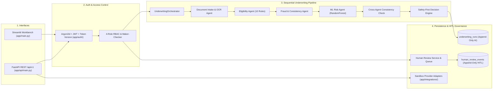

### Fail-Closed Decision Precedence & State Separation

The system enforces strict immutability and never lets human review outcomes overwrite original AI outputs:

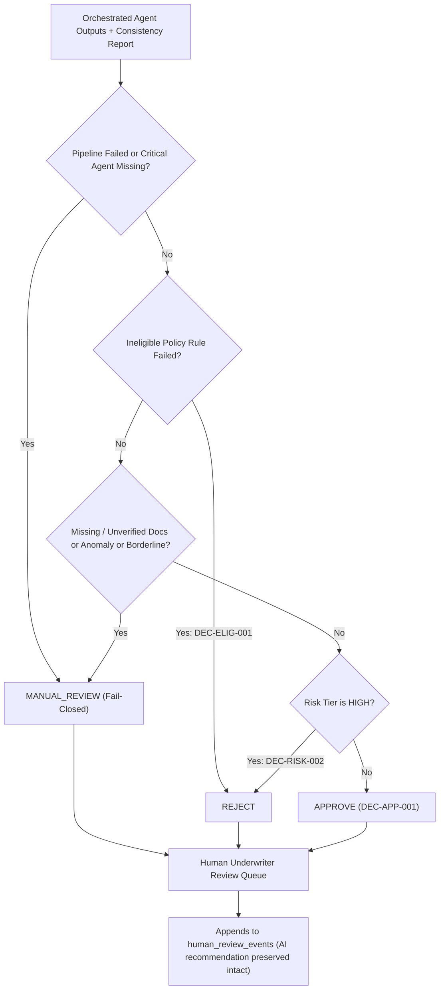

See [`PROJECT_ARCHITECTURE.md`](PROJECT_ARCHITECTURE.md) for the complete schema design, concurrency locks, and SQLite-to-PostgreSQL migration architecture.

---

## 📸 Application Showcase

*Real screenshots captured from live local Streamlit (`app/main.py`) and FastAPI (`/api/docs`) instances over synthetic applicant cohorts:*

<table>
  <tr>
    <td width="50%">
      <strong>Portfolio Dashboard & Separated KPIs</strong><br/>
      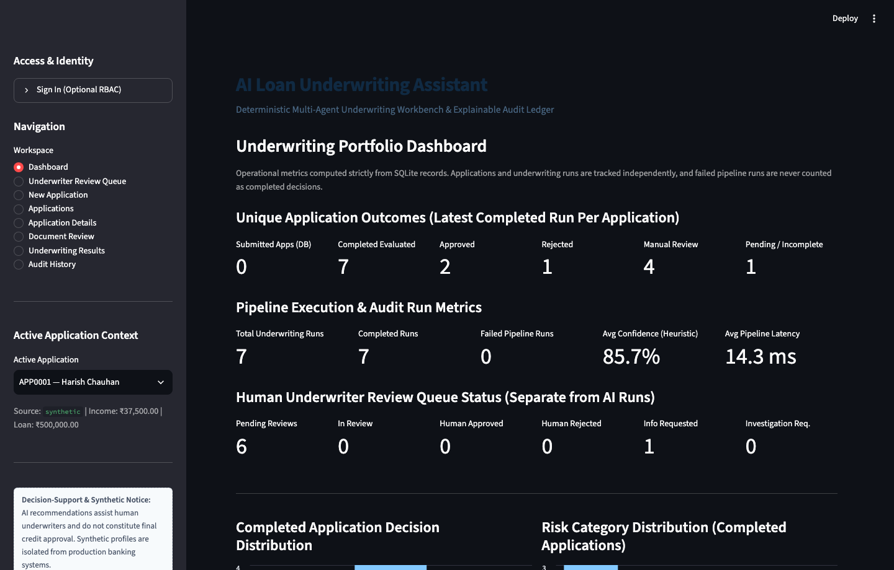
    </td>
    <td width="50%">
      <strong>Underwriting Results & Explainability</strong><br/>
      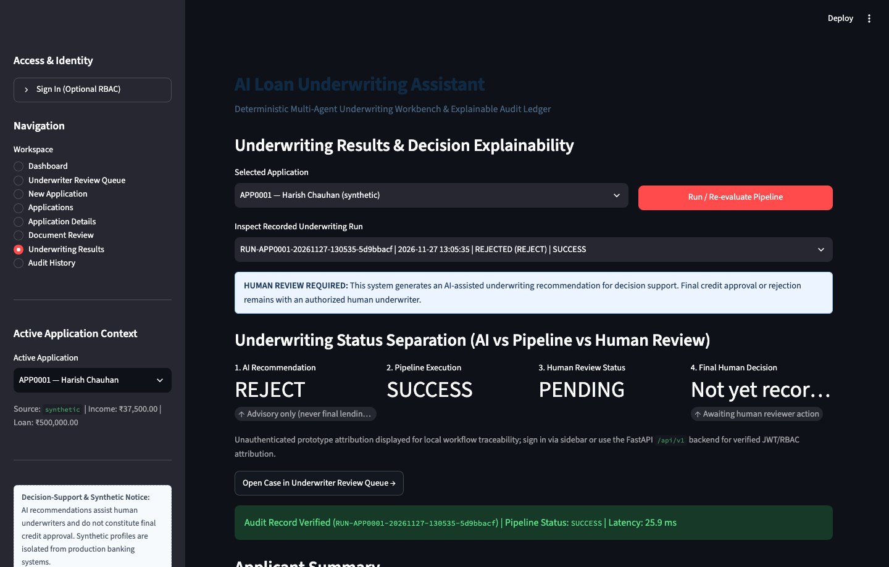
    </td>
  </tr>
  <tr>
    <td width="50%">
      <strong>Document Review, OCR Telemetry & PII Masking</strong><br/>
      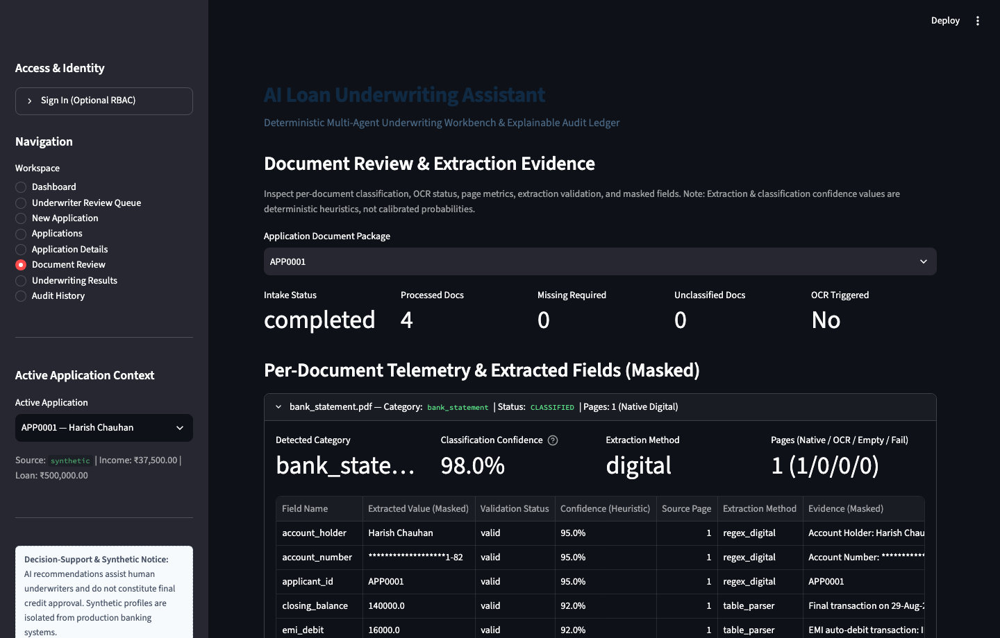
    </td>
    <td width="50%">
      <strong>Human Underwriter Decision Workbench</strong><br/>
      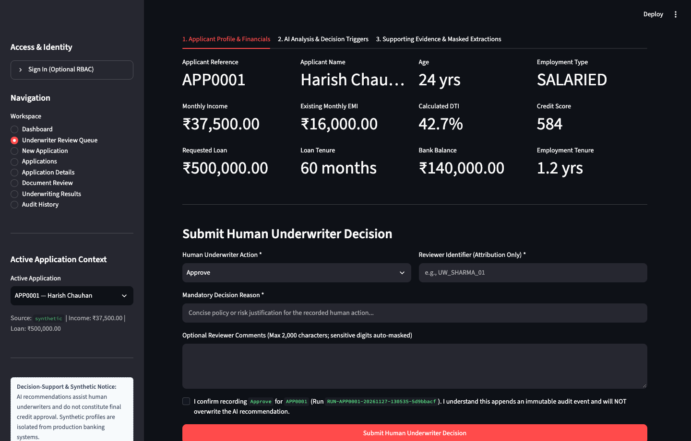
    </td>
  </tr>
  <tr>
    <td width="50%">
      <strong>Immutable Audit History Ledger</strong><br/>
      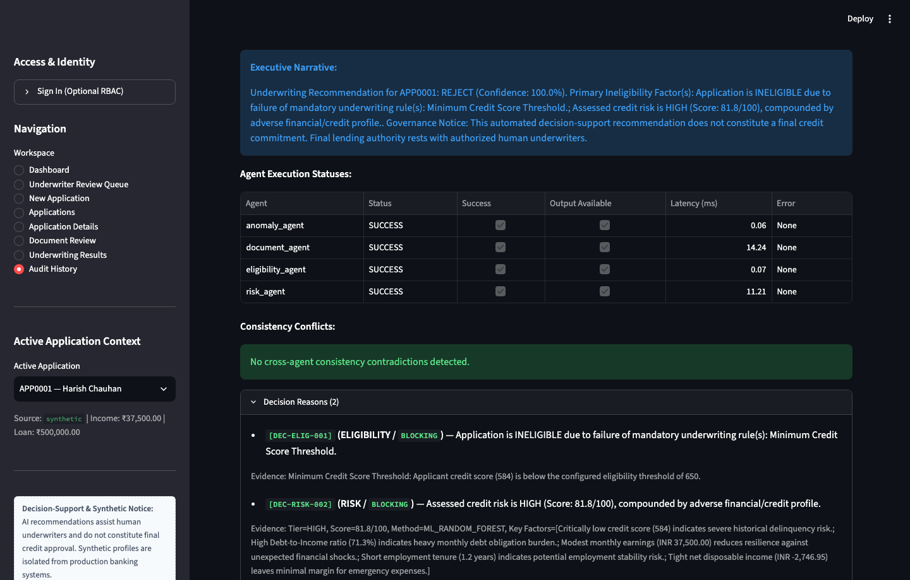
    </td>
    <td width="50%">
      <strong>FastAPI v1 OpenAPI Documentation</strong><br/>
      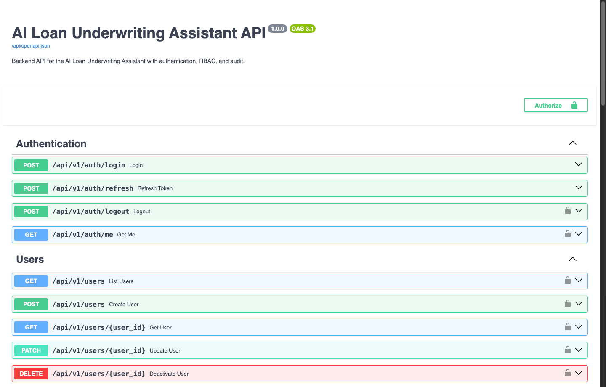
    </td>
  </tr>
</table>

<details>
<summary><b>View 4 Additional Screenshots (Login Gate, Application Intake, Details, Review Queue)</b></summary>

<table>
  <tr>
    <td width="50%">
      <strong>Production RBAC Login Gate</strong><br/>
      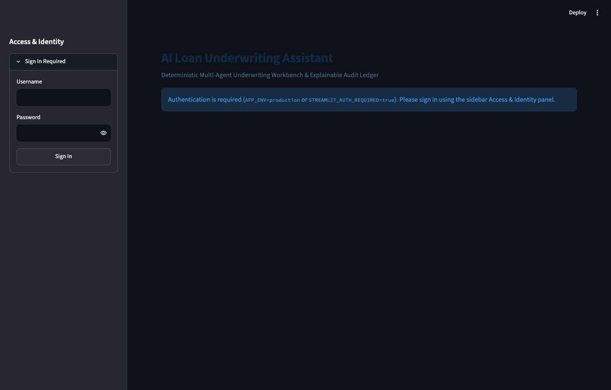
    </td>
    <td width="50%">
      <strong>Schema-Validated Intake & PDF Upload</strong><br/>
      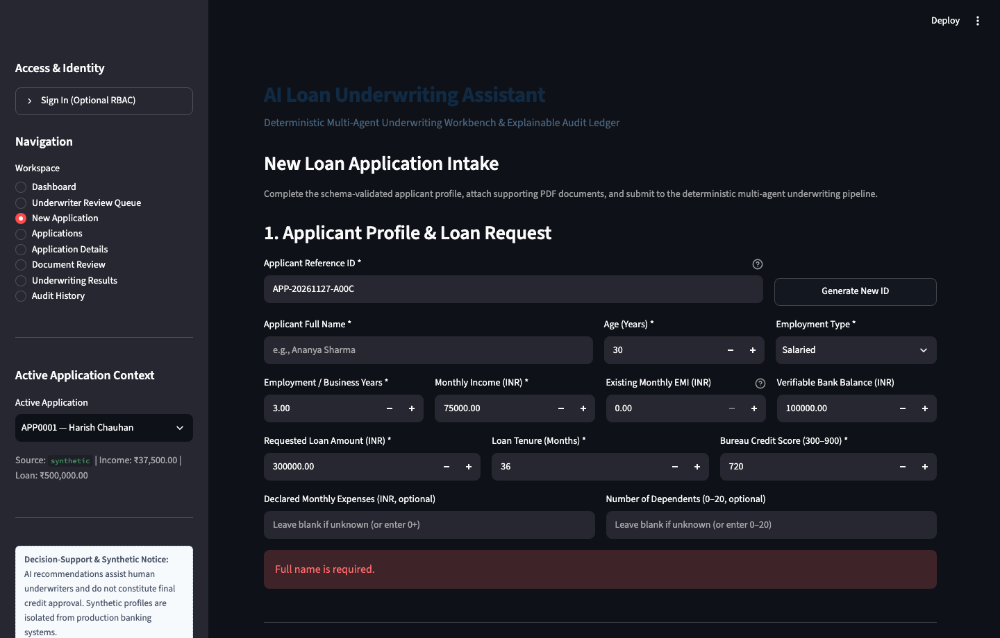
    </td>
  </tr>
  <tr>
    <td width="50%">
      <strong>Application Details & Multi-Run History</strong><br/>
      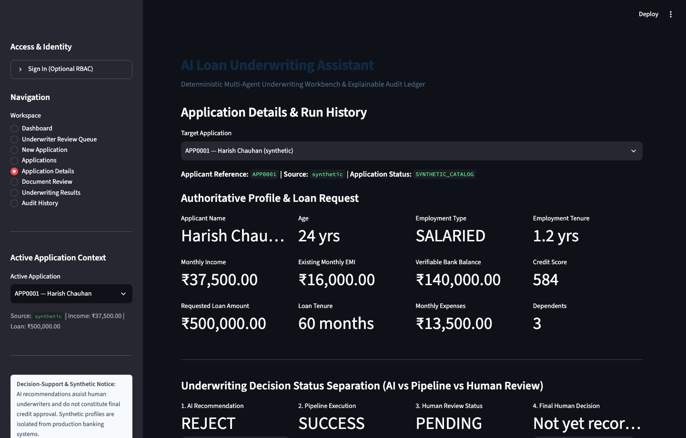
    </td>
    <td width="50%">
      <strong>Human Underwriter Review Queue</strong><br/>
      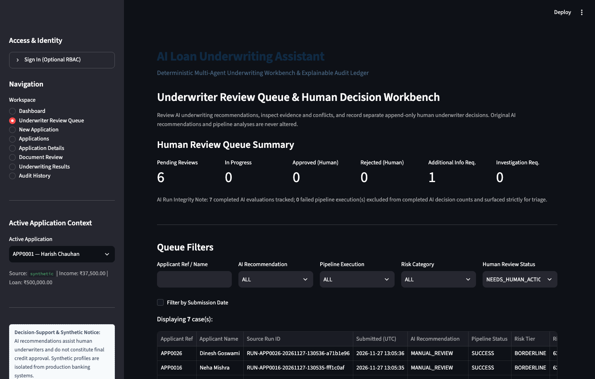
    </td>
  </tr>
</table>

</details>

---

## 🚀 Quick Start

**Prerequisites:** Python `3.11+` and **Tesseract OCR** (`brew install tesseract` on macOS / `sudo apt-get install tesseract-ocr` on Linux).

```bash
# 1. Create virtual environment & install dependencies
python3 -m venv .venv && source .venv/bin/activate
pip install -r requirements.txt

# 2. Configure local environment & initialize isolated database via Alembic
cp .env.example .env
export DATABASE_URL="sqlite:////tmp/demo_underwriting.db"
.venv/bin/alembic upgrade head

# 3. Launch FastAPI Backend (Swagger at http://127.0.0.1:8000/api/docs)
.venv/bin/uvicorn app.api.main:app --reload --port 8000

# 4. Launch Streamlit Workbench (in a new terminal)
DATABASE_URL="sqlite:////tmp/demo_underwriting.db" .venv/bin/streamlit run app/main.py
```

### Optional Authenticated Demo Setup (4 Roles)

Provision local synthetic demo accounts using environment-provided passwords (refused automatically if `APP_ENV=production`) and follow the 15-step walkthrough in [`DEMO_GUIDE.md`](DEMO_GUIDE.md):

```bash
DATABASE_URL="sqlite:////tmp/demo_underwriting.db" \
ALLOW_DEMO_SEED=true \
DEMO_ADMIN_PASSWORD="<local-password>" \
DEMO_OFFICER_PASSWORD="<local-password>" \
DEMO_UNDERWRITER_PASSWORD="<local-password>" \
DEMO_SUPERVISOR_PASSWORD="<local-password>" \
.venv/bin/python scripts/seed_demo_users.py --confirm-local-demo

STREAMLIT_AUTH_REQUIRED=true DATABASE_URL="sqlite:////tmp/demo_underwriting.db" \
  .venv/bin/streamlit run app/main.py --server.port 8501
```

---

## 🔐 Security, RBAC & Maker-Checker

| Role | Core Permissions | Restricted From |
| :--- | :--- | :--- |
| `ADMINISTRATOR` | User CRUD, role assignment, account unlock, integration status, audit analytics | Reviewing own submitted/initiated cases |
| `LOAN_OFFICER` | Register applicants, upload `.pdf` docs, run underwriting, view own runs | Review Queue, audit summaries, other officers' apps |
| `UNDERWRITER` | Inspect open queue & evidence, approve/reject, request info, investigate | Decision corrections, user admin, self-reviews |
| `SUPERVISOR` | Full queue/audit oversight + linked post-decision corrections (`is_correction=true`) | User creation, self-reviews |

- **No Client Identity Spoofing:** `POST /api/v1/reviews/submit` enforces `extra="forbid"` and derives `reviewer_user_id`, `reviewer_username`, and `reviewer_role` strictly from verified JWT claims.
- **Session & Token Hardening:** Argon2id hashing, single-use refresh rotation with replay reuse detection, immediate `token_version` invalidation on logout/role-change, per-username + per-IP rate limiting, and fail-closed startup checks when `APP_ENV=production`.
- **Append-Only Audit & Concurrency:** `expected_previous_status` optimistic locking + SQLite `BEGIN IMMEDIATE` serialization (`409 Conflict` on race) + database `BEFORE UPDATE` / `BEFORE DELETE` abort triggers.

---

## 📈 Synthetic Evaluation Results

> [!NOTE]
> All benchmarks below reflect deterministic execution against **synthetic cohorts** (`seed=42`) using isolated temporary SQLite databases — **not** real-world banking default or fraud rates.

| Evaluation Benchmark | Scope | Observed Result |
| :--- | :--- | :--- |
| **Automated Test Suite** (`pytest`) | Unit, API, RBAC, concurrency, DB & Streamlit AppTest | **`300 passed`** (`0 failed`) |
| **Dataset & Artifact Integrity** | `N=100` profiles, `30` PDF packages, feature parity | **`100/100`** valid & parity verified |
| **Document Intelligence & OCR** | `30` packages / `115` PDFs (`4` image scans) | **`100.0%`** doc classification (`115/115`), **`30/30`** missing-set, `1,525` valid fields |
| **Controlled Anomaly Detection** | `6` synthetic cohorts (`15` anomaly, `15` clean/missing) | **`100.0%`** precision/recall (`5/5` missing docs kept non-fraud) |
| **ML Risk Model (`risk_model_rf_v2`)** | `80/20` stratified split (`gender` excluded) | CV: `96.25% ± 3.06%`; Held-out `N=20`: **`95.00%`** acc (`RiskScorer`: `60.00%`) |
| **End-to-End Safety & Determinism** | `30` doc packages + `70` profile-only + `4` failure probes | **`30/30`** deterministic (`4` Approve, `8` Reject, `18` Review); **`4/4`** probes `MANUAL_REVIEW` |

---

## ⚠️ Known Limitations & Roadmap

- **PostgreSQL Runtime (`NOT RUN`):** SQLAlchemy schemas, connection pooling options, Alembic migrations (`0001`, `0002`), and offline PostgreSQL DDL generation are implemented, alongside [`scripts/migrate_sqlite_to_postgres.py`](scripts/migrate_sqlite_to_postgres.py). Runtime cutover requires converting legacy raw `sqlite3` queries in [`app/database/`](app/database/) to SQLAlchemy Core, installing `psycopg`/`psycopg2`, and testing against a live Postgres server.
- **Synthetic Cohort & Confidence Heuristic:** Trained on `N=100` synthetic records; extraction/decision confidences reflect deterministic agreement scores rather than calibrated probabilities.
- **Local Integration Stubs & Legacy JWT Lib:** Credit bureau, KYC, LLM reasoning, and webhooks ([`app/integrations/`](app/integrations/)) are local sandbox/no-op stubs; migrating `python-jose` to `PyJWT` and adding Redis/gateway throttling remain planned maintenance items.

---

## 📂 Technical Details & Reference Drawers

<details>
<summary><b>📁 Project Directory Structure</b></summary>

```text
AI-Loan-Underwriting-Assistant/
├── app/
│   ├── main.py                  # Active Streamlit workbench & CLI verification entry point
│   ├── api/                     # FastAPI /api/v1 app factory, dependencies & 8 route modules
│   ├── auth/                    # Argon2id security, JWT tokens, RBAC matrix & AuthService
│   ├── agents/                  # Orchestrator & specialized underwriting agent facades
│   ├── document_processing/     # Stage 3 PDF reader, Tesseract OCR, classifier & validators
│   ├── eligibility/             # 10 deterministic eligibility policy rules
│   ├── fraud/                   # Cross-document consistency checks (ANOM-*) & scoring
│   ├── risk/                    # 15-feature contract, baseline scorer & RandomForest wrapper
│   ├── decision/                # 7-tier DecisionReasoningAgent & explainable summary builder
│   ├── orchestration/           # Dependency DAG coordinator & cross-agent consistency check
│   ├── review/                  # Server-side HITL state machine & Maker-Checker guards
│   ├── database/                # SQLite ledgers, SQLAlchemy schemas, pooling & migration helpers
│   ├── integrations/            # Sandbox/disabled external provider adapters
│   ├── schemas/                 # Pydantic v2 domain & API contracts
│   └── ui/                      # 8-page Streamlit workbench & session state helpers
├── alembic/                     # Schema migrations (0001_stage7_initial -> 0002_stage8_hardening)
├── config/settings.py           # Pydantic BaseSettings & production fail-closed validator
├── data/                        # Synthetic applicant CSV/JSON cohorts & 30 PDF packages
├── docs/
│   ├── screenshots/             # 10 live Streamlit & FastAPI PNG captures + index
│   └── stages/                  # Archived Stage 3–9 engineering & audit reports
├── models/                      # risk_model.joblib & risk_model_metadata.json
├── scripts/                     # Dataset generation, training, evaluation, demo seed & PG copy
├── tests/                       # 300 unit, integration, security & AppTest tests
├── DEMO_GUIDE.md                # 10–15 minute academic presentation guide
├── PROJECT_ARCHITECTURE.md      # Deep-dive system design & Mermaid architecture
└── PROJECT_REPORT_OUTLINE.md    # 23-chapter academic capstone report structure
```

*(Note: `frontend/streamlit_app.py` is retained strictly as an obsolete Stage 1 static mockup and is superseded by [`app/main.py`](app/main.py).)*

</details>

<details>
<summary><b>⚙️ Environment Variables Reference (Dev & Production Templates)</b></summary>

Copy [`.env.example`](.env.example) for local runs or review [`.env.production.example`](.env.production.example) (no real credentials):

| Variable | Description | Dev Default |
| :--- | :--- | :--- |
| `APP_ENV` | `development`, `test`, or `production` | `development` |
| `DATABASE_URL` | SQLite or PostgreSQL URI | `sqlite:///./loan_underwriting.db` |
| `JWT_SECRET_KEY` | Signing secret (**mandatory 32+ chars in production**) | `DEV-ONLY-...` |
| `JWT_ALGORITHM` | Allowed HMAC algorithm (`HS256`, `HS384`, `HS512`) | `HS256` |
| `STREAMLIT_AUTH_REQUIRED` | Enforces login gate in UI (auto-on in `production`) | `false` |
| `CORS_ALLOWED_ORIGINS` | Comma-separated origin allowlist (`*` blocked in prod) | `http://localhost:8501,...` |
| `LOGIN_RATE_LIMIT_MAX_ATTEMPTS` | Failed logins per window before sliding block | `5` |
| `MAX_FAILED_LOGIN_ATTEMPTS` | Failed attempts before `users.is_locked = True` | `10` |

</details>

<details>
<summary><b>🧪 Full Test, Lint & Evaluation Command Reference</b></summary>

```bash
# Run complete 300-test suite against an isolated database
DATABASE_URL="sqlite:////tmp/test_audit.db" .venv/bin/pytest -q

# Lint and format checks
.venv/bin/ruff check . && .venv/bin/black --check .

# Re-run stage evaluation benchmarks
DATABASE_URL="sqlite:////tmp/test_eval.db" .venv/bin/python scripts/validate_dataset.py
DATABASE_URL="sqlite:////tmp/test_eval.db" .venv/bin/python scripts/evaluate_extraction.py
DATABASE_URL="sqlite:////tmp/test_eval.db" .venv/bin/python scripts/evaluate_eligibility.py
DATABASE_URL="sqlite:////tmp/test_eval.db" .venv/bin/python scripts/evaluate_risk_model.py
DATABASE_URL="sqlite:////tmp/test_eval.db" .venv/bin/python scripts/evaluate_anomaly_detection.py
DATABASE_URL="sqlite:////tmp/test_eval.db" .venv/bin/python scripts/evaluate_end_to_end.py
```

</details>

---

## 📚 Documentation Index

| Document | Purpose |
| :--- | :--- |
| [`PROJECT_ARCHITECTURE.md`](PROJECT_ARCHITECTURE.md) | Component breakdown, schema relationships, state separation & data flow |
| [`DEMO_GUIDE.md`](DEMO_GUIDE.md) | Step-by-step 15-part presentation guide with expected UI outcomes |
| [`PROJECT_REPORT_OUTLINE.md`](PROJECT_REPORT_OUTLINE.md) | 23-chapter academic capstone report template with artifact mappings |
| [`docs/stages/STAGE_8_PRODUCTION_READINESS.md`](docs/stages/STAGE_8_PRODUCTION_READINESS.md) | Risk register, security hardening details, test counts & readiness verdict |
| [`docs/stages/README.md`](docs/stages/README.md) | Chronological archive of all Stage 3–9 engineering reports |
| [`docs/screenshots/README.md`](docs/screenshots/README.md) | Visual index of all 10 live application screenshots |
